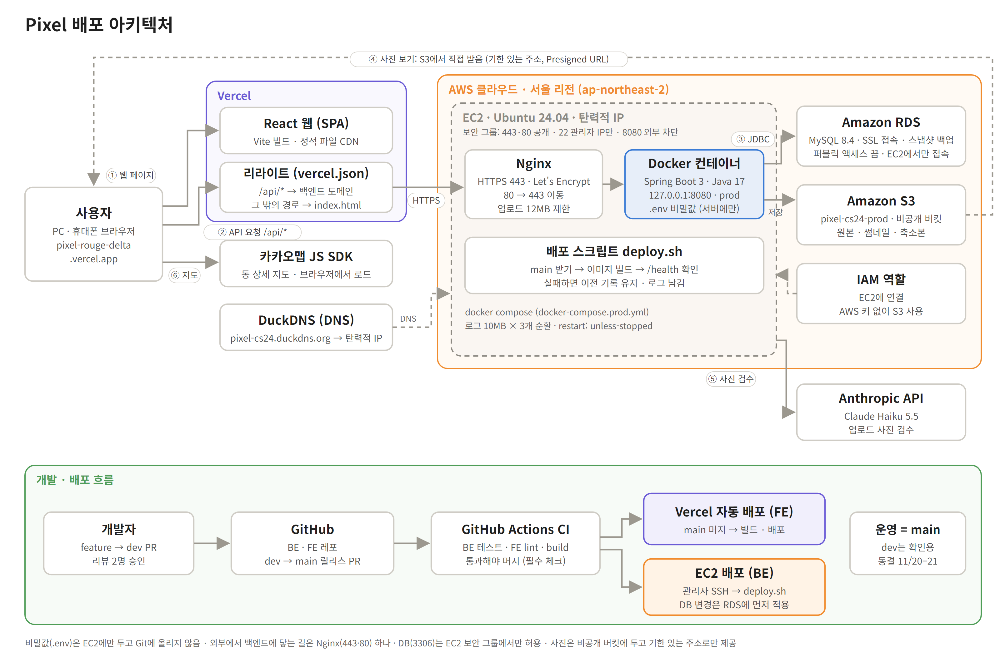

# Pixel (픽셀) — Backend

> **사진의 색으로 그리는 동네 여행 지도**
> 2026 컴퓨터정보공학부 학술제 CLUEDAY · 팀 CS24

"모두의 사진으로 동네의 색을 칠해, 동네를 놀러 갈 곳으로 만드는 지도"

사진에 담긴 색·촬영 시각·위치를 행정동 단위로 모아, 이름난 관광지뿐 아니라 동네 자체를 "언제 가면 어떤 색을 볼 수 있는 곳"으로 보여 주는 서비스입니다.

- **서비스:** https://pixel-rouge-delta.vercel.app
- **API 서버:** https://pixel-cs24.duckdns.org
- **프론트엔드 레포지토리:** https://github.com/Academic-Festival-2026-2/FE
- **데이터 범위:** 경기도 31개 시·군 601개 행정동 × 4계절 × 4시간대(새벽·낮·노을·밤)

## 문서

| 문서 | 위치 |
|---|---|
| API 명세서 · DB ERD | 별도 제출 · 테이블 정의는 [`pixel/db/01_schema.sql`](pixel/db/01_schema.sql) |
| 배포 아키텍처 | 아래 [아키텍처](#아키텍처) · 운영 절차는 [docs/DEPLOY.md](docs/DEPLOY.md) |
| Swagger UI (로컬 실행 시) | http://localhost:8080/swagger-ui/index.html |
| 협업 규칙 (브랜치·커밋·PR) | [.github/CONTRIBUTING.md](.github/CONTRIBUTING.md) |

## 주요 기능

- **회원:** 이메일 회원가입·로그인, JWT(Access 30분 / Refresh 14일, Refresh Token Rotation), 내 정보·비밀번호 변경, 회원 탈퇴(소프트 삭제)
- **공유 지도:** 지역 목록·동 경계(GeoJSON), 시간대·계절별 동 대표색과 색 비율, 사진 많은 동 Top 3
- **동 상세:** 시간대 4개의 색 요약, 공개 사진 지점
- **사진 업로드:** EXIF로 촬영 시각·좌표 확인, 좌표로 행정동 판정, AI 검수(Claude), 칸 대표색 집계, 배지 지급
- **나의 지도:** 내 사진으로 칠한 칸, 공유 링크 만들기·중지, 공유된 나의 지도 보기
- **사진 관리:** 내 사진 목록(계절별), 공개 여부 변경, 삭제, 좋아요·좋아요한 사진 목록

## 아키텍처



- 브라우저 → Vercel(FE) → `/api/*` 리라이트 → EC2 Nginx(HTTPS) → Spring Boot 컨테이너 → RDS(MySQL) · S3
- 사진은 비공개 S3 버킷에 두고 5분짜리 서명 URL로만 보여 주며, 업로드 사진 검수는 Anthropic API(Claude Haiku)를 부릅니다.
- EC2는 IAM 역할로 S3에 접근해 서버에 AWS 키가 없고, 비밀값은 EC2의 `.env`에만 둡니다.

## 기술 스택

| 구분 | 사용 기술 |
|---|---|
| Language | Java 17 |
| Framework | Spring Boot 3.5, Spring Security, Spring Data JPA, Validation, Cache |
| 인증 | JWT (jjwt 0.12) |
| Database | MySQL 8 (운영 RDS 8.4, 공간 타입 SRID 4326으로 행정동 경계 판정) |
| 저장소 | Amazon S3 (AWS SDK v2) |
| 외부 API | Anthropic API (사진 검수), metadata-extractor (EXIF) |
| 문서화 | springdoc-openapi (Swagger UI) |
| Test | JUnit 5, Spring Security Test, H2 (MySQL 모드) |
| Infra | AWS EC2 · RDS · S3 · IAM, Docker Compose, Nginx, Let's Encrypt, DuckDNS |
| CI | GitHub Actions (PR마다 테스트, dev 머지 필수 체크) |

## API

모든 API는 `/api` 아래에 있고, 로그인이 필요한 API는 `Authorization: Bearer {accessToken}` 헤더를 보냅니다.
요청·응답 필드와 에러 코드는 API 명세서(별도 제출)와 로컬 Swagger UI에서 볼 수 있습니다.

| 구분 | Method | Endpoint | 설명 | 로그인 |
|---|---|---|---|---|
| 인증 | `POST` | `/api/auth/signup` | 회원가입 | X |
| 인증 | `POST` | `/api/auth/login` | 로그인 (Access·Refresh Token 발급) | X |
| 인증 | `POST` | `/api/auth/reissue` | 토큰 재발급 (Rotation) | X |
| 인증 | `POST` | `/api/auth/logout` | 로그아웃 (Refresh Token 삭제) | O |
| 회원 | `GET` | `/api/users/me` | 내 정보 조회 (사진 수, 채운 칸 수 포함) | O |
| 회원 | `PATCH` | `/api/users/me` | 내 정보 수정 (닉네임, 위치정보 동의, 프로필 이미지) | O |
| 회원 | `PATCH` | `/api/users/me/password` | 비밀번호 변경 | O |
| 회원 | `DELETE` | `/api/users/me` | 회원 탈퇴 | O |
| 지도 | `GET` | `/api/map/regions` | 지역 목록 | X |
| 지도 | `GET` | `/api/map/boundaries` | 지역의 동 경계 (GeoJSON) | X |
| 지도 | `GET` | `/api/map/dongs` | 동별 칸 색, 인기 동 Top 3 | X |
| 동 | `GET` | `/api/dongs/{dongCode}` | 동 상세 (시간대별 색, 사진 지점) | X |
| 사진 | `POST` | `/api/photos` | 사진 업로드 (multipart) | O |
| 사진 | `GET` | `/api/photos/{photoId}` | 사진 상세 | 선택 |
| 사진 | `PATCH` | `/api/photos/{photoId}` | 공개 여부 변경 | O |
| 사진 | `DELETE` | `/api/photos/{photoId}` | 사진 삭제 | O |
| 사진 | `POST` | `/api/photos/{photoId}/likes` | 좋아요 | O |
| 사진 | `DELETE` | `/api/photos/{photoId}/likes` | 좋아요 취소 | O |
| 사진 | `GET` | `/api/users/me/photos` | 내 사진 목록 (계절 필터) | O |
| 사진 | `GET` | `/api/users/me/liked-photos` | 좋아요한 사진 목록 | O |
| 나의 지도 | `GET` | `/api/users/me/map` | 나의 지도 | O |
| 나의 지도 | `GET` | `/api/users/me/map/dongs/{dongCode}` | 동의 내 사진 지점 | O |
| 나의 지도 | `GET` | `/api/users/me/map/share` | 공유 상태 조회 | O |
| 나의 지도 | `POST` | `/api/users/me/map/share` | 공유 링크 만들기 | O |
| 나의 지도 | `DELETE` | `/api/users/me/map/share` | 공유 중지 | O |
| 공유 지도 | `GET` | `/api/shared-maps/{shareKey}` | 공유된 나의 지도 조회 | X |
| 배지 | `GET` | `/api/users/me/badges` | 내 배지 목록 | O |
| 기타 | `GET` | `/health` | 서버 상태 확인 (배포 스크립트용, 본문 `OK` 텍스트) | X |

"선택"은 로그인하지 않아도 되지만, 로그인하면 결과가 달라지는 API입니다 (비공개 사진은 올린 회원만 조회).

### 공통 응답 형식

```json
{
  "isSuccess": true,
  "code": "USER200_2",
  "message": "로그인에 성공했습니다.",
  "result": {
    "accessToken": "eyJ...",
    "refreshToken": "eyJ..."
  }
}
```

- 실패하면 `isSuccess: false`입니다. 입력값 오류는 `result`에 필드별 메시지가, 서버 오류(`COMMON500`)는 추적 ID가 들어갑니다.
- 돌려줄 값이 없으면 `result`를 뺍니다.
- 코드는 `{도메인}{HTTP 상태}_{번호}` 형식입니다. (예: `USER401_1`, `PHOTO422_1`, `COMMON500`)

## 프로젝트 구조

```
pixel/
├── db/                     # 테이블·초기 데이터 SQL (아래 "데이터베이스 만들기")
└── src/main/java/com/pixel
    ├── domain
    │   ├── user            # 회원가입·로그인·내 정보·탈퇴
    │   ├── refreshtoken    # Refresh Token 저장
    │   ├── region          # 지역(시·군)
    │   ├── dong            # 행정동, 동 상세
    │   ├── season          # 계절
    │   ├── map             # 공유 지도 (지역 목록, 경계, 동별 칸 색)
    │   ├── colorcell       # 칸(동 × 계절 × 시간대) 색 집계
    │   ├── photo           # 사진 업로드·조회·좋아요, AI 검수(moderation)
    │   ├── mymap           # 나의 지도, 공유 링크
    │   └── badge           # 배지
    └── global
        ├── apiPayload      # 공통 응답, 성공·에러 코드, 전역 예외 처리
        ├── common          # BaseEntity (생성·수정 시각)
        ├── config          # Swagger, 업로드 설정
        ├── security        # Spring Security, JWT 필터, 공개 경로
        └── storage         # S3 저장소
```

도메인 안은 `controller / dto / entity / repository / service / exception` 폴더로 나눕니다.

## 실행 방법

### 1. 사전 준비

- JDK 17
- MySQL 8.0.17 이상 (또는 Docker)

### 2. 데이터베이스 만들기

테이블은 `pixel/db/`의 SQL로 만들고, 서버는 엔티티와 맞는지만 검사합니다(`ddl-auto: validate`). **SQL을 먼저 실행해야 서버가 뜹니다.**

```
pixel/db/
├── 01_schema.sql   # 테이블 전체
├── 02_dongs.sql    # 부천 37개 동 경계 (SGIS, 기준일 20250630) + 부천시 지역 1행
├── 03_seed.sql     # 4계절 + 빈 칸
├── dongs/          # 경기도 30개 시·군 경계 (자동 실행 안 함, dongs/README.md 참고)
├── migration/      # 이미 만들어진 DB에 적용할 변경 SQL (자동 실행 안 함, docs/DEPLOY.md 참고)
└── legacy/         # 옛 테이블 정리용 (자동 실행 안 함)
```

**Docker로 실행할 때** — DB가 처음 만들어질 때 세 파일이 순서대로 자동 실행되고, 끝난 뒤에 서버가 켜집니다. 예전에 띄운 DB가 있으면 `docker compose down -v`로 볼륨을 지운 뒤 실행합니다. (로컬 DB 데이터도 지워집니다)

```bash
cd pixel
docker compose up -d
```

**로컬 MySQL로 실행할 때** — `pixel` 폴더에서 데이터베이스를 만들고 세 파일을 순서대로 실행합니다. (기존 `pixel` DB 데이터는 지워집니다)

```bash
cd pixel
mysql -u root -p -e "DROP DATABASE IF EXISTS pixel; CREATE DATABASE pixel DEFAULT CHARACTER SET utf8mb4;"
mysql -u root -p --default-character-set=utf8mb4 pixel -e "source db/01_schema.sql"
mysql -u root -p --default-character-set=utf8mb4 pixel -e "source db/02_dongs.sql"
mysql -u root -p --default-character-set=utf8mb4 pixel -e "source db/03_seed.sql"
```

- 확인: `SELECT (SELECT COUNT(*) FROM dongs), (SELECT COUNT(*) FROM seasons), (SELECT COUNT(*) FROM color_cells);` → `37`, `4`, `592`
- 경기도 전체 경계를 넣으려면 [`pixel/db/dongs/README.md`](pixel/db/dongs/README.md)를 따릅니다. (넣은 뒤 서버 재시작)

### 3. 환경 변수

로컬에서는 환경 변수 없이도 기본값으로 실행됩니다. 바꾸고 싶은 값만 [`pixel/src/main/resources/.env.example`](pixel/src/main/resources/.env.example)을 참고해 지정하세요.

| 변수 | 기본값 | 설명 |
|---|---|---|
| `JWT_SECRET` | 로컬용 기본키 (`application.yml`) | JWT 서명 키 (Base64, 256bit 이상). **배포(`prod`)에서는 반드시 지정** |
| `DB_URL` | `jdbc:mysql://localhost:3306/pixel...` | DB 접속 URL |
| `DB_USERNAME` / `DB_PASSWORD` | `root` / `password` | DB 계정 |
| `SERVER_PORT` | `8080` | 서버 포트 |
| `AWS_S3_BUCKET` | 없음 | 사진 저장 버킷. 없으면 사진 업로드만 실패 |
| `AWS_REGION` | `ap-northeast-2` | S3 리전 (서울) |
| `AWS_ACCESS_KEY_ID` / `AWS_SECRET_ACCESS_KEY` | 없음 | 로컬 개발용 S3 키 (배포 서버는 IAM 역할 사용). **Git·단체방에 올리지 않기** |
| `MODERATION_ENABLED` | `false` | 사진 AI 검수 켜기. 꺼져 있으면 모든 사진을 `PUBLIC`으로 처리 |
| `ANTHROPIC_API_KEY` | 없음 | AI 검수용 키 (`MODERATION_ENABLED=true`일 때 필요) |

`.env`는 Spring이 직접 읽지 않습니다. IntelliJ 실행 구성 → 환경 변수 → 폴더 아이콘으로 `.env` 파일을 연결해야 적용됩니다.

### 4. 실행

```bash
cd pixel
./gradlew bootRun
```

- Swagger UI: http://localhost:8080/swagger-ui/index.html (로그인이 필요한 API는 오른쪽 위 Authorize에 Access Token 입력)
- 헬스 체크: http://localhost:8080/health
- 운영(`prod`) 프로필에서는 Swagger를 끕니다.

### 5. 테스트

```bash
cd pixel
./gradlew test
```

H2 메모리 DB를 써서 MySQL·AWS 키 없이 돌아갑니다. GitHub Actions가 모든 PR에서 같은 테스트를 돌립니다.

## 배포

- 운영 브랜치는 `main`입니다. dev → main 릴리스 PR을 머지한 뒤, EC2에서 `scripts/deploy.sh`로 반영합니다. (최신 main 받기 → 이미지 빌드 → `/health` 확인. 빌드 전 점검에서 문제가 있으면 서버를 바꾸지 않고 멈추고, 배포 중 실패하면 로그와 되돌리는 명령을 보여 줌)
- DB 변경은 `db/migration/`의 SQL을 RDS에 직접 적용합니다. 추가·변경은 배포 전, 삭제는 배포 후에 적용합니다.
- 외부에서 들어오는 길은 Nginx(443·80) 하나이고, 백엔드(8080)와 DB(3306)는 밖에서 접근할 수 없습니다.
- 마이그레이션 순서, 배포 스크립트 옵션, 보안 그룹, Nginx·HTTPS·도메인 설정은 [docs/DEPLOY.md](docs/DEPLOY.md)에 있습니다.

## 협업 규칙

- 브랜치: `{타입}/{이슈번호}-{내용}` → **dev로 PR**, 리뷰 2명 승인 + CI 통과 후 머지. main은 dev → main 릴리스 PR로만 반영
- 커밋: `[타입] 내용 #이슈번호` (예: `[feat] 로그인 구현 #9`)
- 코드 스타일: Google Java Style
- 자세한 내용은 [CONTRIBUTING.md](.github/CONTRIBUTING.md)

## 외부 데이터

- 통계지리정보서비스(SGIS) 행정구역 경계 — 경기도 31개 시·군 행정동 경계 (기준일 20250630)

## 팀원

| 이름 | 역할 |
|---|---|
| 서재민 | 팀장 / Architect |
| 권도현 | Dev |
| 김세훈 | Dev |
| 김우용 | Dev |
| 임현진 | Design |
